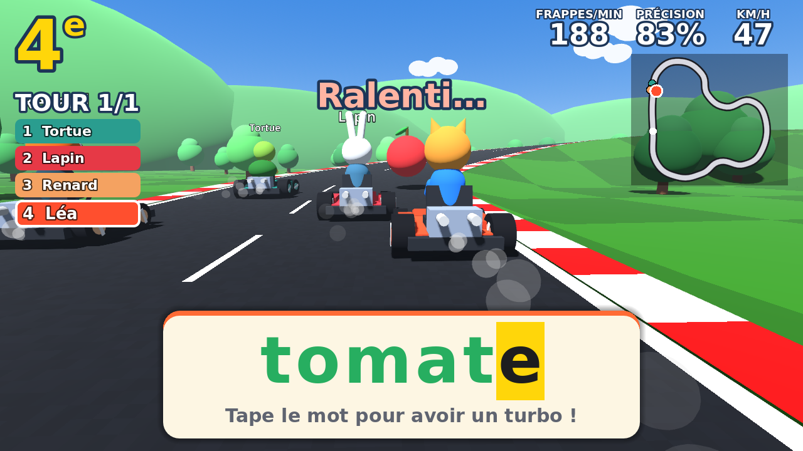
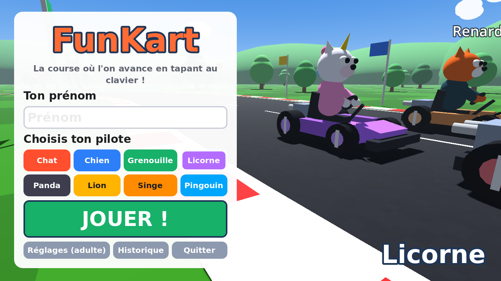
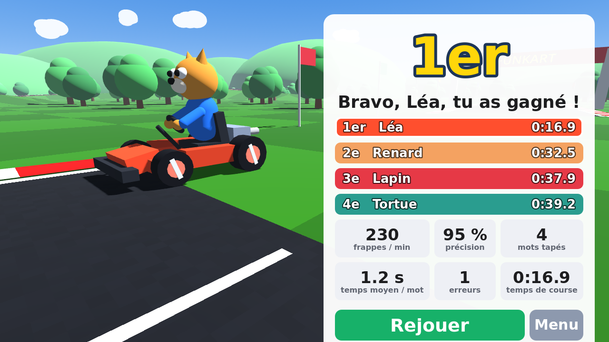

# FunKart

Jeu vidéo pédagogique permettant de prendre en main le clavier sous forme de jeu.

Une course de karts en 3D, vue à la troisième personne derrière le kart, dans
l'esprit des jeux de kart. L'enfant **ne pilote pas** : son kart roule tout
seul. La seule façon d'aller plus vite, c'est de **taper au clavier les mots
qui apparaissent à l'écran**.

| Menu et choix du pilote | Arrivée |
| --- | --- |
|  |  |

## Jouer

- **Windows** : télécharger `FunKart.exe` et double-cliquer dessus. Aucune
  installation n'est nécessaire. Windows peut afficher « Windows a protégé votre
  ordinateur » : cliquer sur « Informations complémentaires » puis
  « Exécuter quand même ».
- **Linux** : `FunKart.x86_64`, à rendre exécutable puis à lancer.

Les fichiers sont produits automatiquement par GitHub à chaque modification :
onglet **Actions** du dépôt → dernière exécution de « Construire le jeu » →
section **Artifacts**.

<kbd>F11</kbd> : plein écran. <kbd>Échap</kbd> : pause.

## Règles

- Le kart avance en pilote automatique (pas d'accélération, de frein ni de direction).
- Régulièrement, un mot apparaît en grand en bas de l'écran, et un objet
  (banane, champignon, étoile, fruit, cadeau, ballon ou boîte « ? ») apparaît
  devant le kart.
- **Tant que le mot n'est pas entièrement tapé, le kart ralentit.**
- **Dès que le mot est tapé, l'objet éclate et le kart reçoit un turbo.**
- La lettre attendue est surlignée en jaune. Une mauvaise touche ne fait pas
  avancer le mot : le mot tremble et le jeu indique la lettre à chercher.
- Les touches maintenues enfoncées ne comptent qu'une fois (pas de répétition
  automatique).
- Majuscules et minuscules sont toujours acceptées ; les accents sont
  facultatifs par défaut (on peut taper `e` pour `é`).
- Les adversaires (Tortue, Lapin, Renard, Ours, Souris) suivent exactement les
  mêmes règles : ils « tapent » leurs mots à une vitesse en **frappes par
  minute** réglée par l'adulte.

## Suivi de l'enfant

Pendant la course et à l'arrivée :

- **frappes par minute** : bonnes frappes ÷ temps passé avec un mot à l'écran
  (les moments sans mot ne sont pas comptés) ;
- **précision** : bonnes frappes ÷ total des frappes ;
- nombre de mots, temps moyen par mot, erreurs, temps de course, place.

Chaque course est enregistrée dans l'**historique** (menu → Historique),
exportable en CSV pour Excel ou LibreOffice (fichier `FunKart_historique.csv`
dans le dossier Documents).

## Réglages (menu → Réglages (adulte))

| Réglage | Effet |
| --- | --- |
| Nombre de tours | Longueur de la course (3 par défaut) |
| Nombre d'adversaires | 0 à 5 |
| Frappes/min de chaque adversaire | Leur niveau, à régler selon l'objectif de l'enfant (préréglages disponibles) |
| Pause entre deux mots | Temps de répit après chaque mot |
| Durée d'un tour sans mot | Vitesse de base des karts |
| Ralentissement / turbo | Intensité de la pénalité et de la récompense |
| Longueur max des mots | Filtre la liste de mots |
| Taille du mot, MAJUSCULES | Lisibilité (les touches du clavier sont souvent en majuscules) |
| Accents facultatifs | Accepte `e` pour `é`, etc. |
| Lire le mot à voix haute | Synthèse vocale du système (si une voix française est installée) |
| Sons, musique, plein écran | |
| Liste de mots | Un mot par ligne |

Avec les réglages par défaut (3 tours), une course dure environ 1 min 45 pour
un enfant à 20 frappes/min, qui arrive en moyenne 2e ou 3e contre des
adversaires réglés à 16, 20 et 24 frappes/min.

## Pour les développeurs

Le jeu est fait avec [Godot 4.4](https://godotengine.org) (gratuit et libre),
avec le moteur de rendu « Compatibilité » pour tourner sur des ordinateurs
modestes. Tous les modèles 3D, sons et musiques sont générés par le code :
il n'y a aucun fichier externe.

- Ouvrir le projet : lancer Godot 4.4 et importer `project.godot`.
- Test automatique (une course jouée avec de vrais événements clavier) :
  `godot --headless --path . --script res://tests/autoplay.gd -- --fast`
- Export : `godot --headless --export-release "Windows" build/windows/FunKart.exe`

| Fichier | Rôle |
| --- | --- |
| `scripts/race_logic.gd` | Règles de la course : vitesse, mots, turbo, adversaires, statistiques |
| `scripts/main.gd` | Enchaînement menu → course → arrivée, caméra, objets, couloirs |
| `scripts/track.gd` | Circuit (route, vibreurs, talus, décor, tribune, arche) |
| `scripts/kart.gd`, `scripts/characters.gd` | Karts et pilotes animaux |
| `scripts/props.gd` | Objets à esquiver |
| `scripts/hud.gd`, `scripts/menu.gd`, `scripts/results.gd`, `scripts/ui.gd` | Interface |
| `scripts/sfx.gd` | Sons, musique, voix |
| `scripts/settings.gd`, `scripts/history.gd` | Réglages et historique enregistrés |
